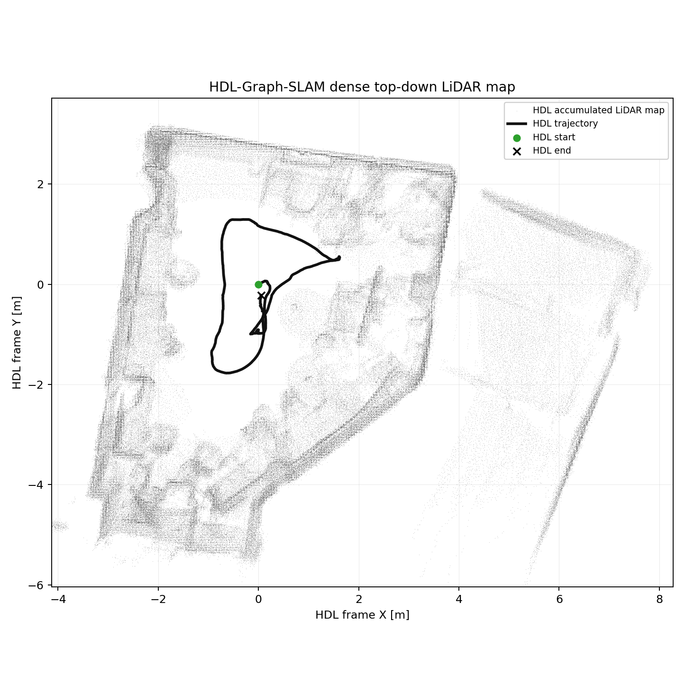

# HDL-GRAPH-SLAM ROS 2 runtime bundle

ROS 2 Humble port의 `hdl_graph_slam`, CPU `fast_gicp`, `ndt_omp` 실행 소스다. 예제 PCD/bag과 upstream 문서 이미지는 제외했다. 공식 프로젝트는 [hdl_graph_slam](https://github.com/koide3/hdl_graph_slam), [fast_gicp](https://github.com/SMRT-AIST/fast_gicp), [ndt_omp](https://github.com/koide3/ndt_omp)이며 각 폴더의 LICENSE를 따른다. g2o의 cholmod solver 조합에는 GPL 조건이 추가될 수 있다.

이 코드는 upstream ROS 1 저장소 그대로가 아니라 내부 이관 commit `ae17d6d8ed15ac766019d61fdcebd185123d75c8`의 ROS 2 Humble custom snapshot이다. upstream 링크는 출처와 예제 데이터 획득용이며 현재 source tree를 대체하는 설치 명령이 아니다.

## 환경과 빌드

Ubuntu 22.04, ROS 2 Humble, C++17, PCL, Eigen3, OpenMP, Boost, yaml-0.1, libusb, Qhull, g2o/SuiteSparse가 필요하다. `fast_gicp`는 이 번들에서 CPU 경로만 빌드하며 CUDA/pybind thirdparty는 싣지 않았다.

```bash
cd HDL-GRAPH-SLAM
mamba env create -f environment.yml
conda activate hdl_graph_slam_humble
cd hdlgraphslam_ws
rosdep install --from-paths src --ignore-src -r -y
colcon build --packages-up-to hdl_graph_slam --cmake-args -DCMAKE_BUILD_TYPE=Release -DBUILD_VGICP_CUDA=OFF -DBUILD_PYTHON_BINDINGS=OFF
source install/setup.bash
```

## 입력 계약과 실행

ROS 2 bag에 `sensor_msgs/PointCloud2`의 `/velodyne_points`가 있어야 하며 frame은 기본 `velodyne`, base frame은 `base_link`다. QoS가 녹화 bag과 맞아야 한다. 공식 ROS 1 예제는 [upstream dataset](https://www.aisl.cs.tut.ac.jp/databases/hdl_graph_slam/hdl_501_filtered.bag.tar.gz)에서 받거나 `scripts/fetch_example_bag.sh`로 받을 수 있다. 이 ROS 2 번들에서 사용하려면 [rosbags 공식 변환 절차](https://ternaris.gitlab.io/rosbags/topics/convert.html)에 따라 변환한다.

```bash
cd HDL-GRAPH-SLAM
bash scripts/fetch_example_bag.sh
tar -xzf hdlgraphslam_ws/data/hdl_501_filtered.bag.tar.gz -C hdlgraphslam_ws/data
bash scripts/convert_ros1_bag.sh \
  hdlgraphslam_ws/data/hdl_501_filtered.bag \
  hdlgraphslam_ws/data/hdl_501_filtered_ros2
bash scripts/check_assets.sh hdlgraphslam_ws/data/hdl_501_filtered_ros2
```

직접 준비한 ROS 2 bag은 변환 없이 아래처럼 검사하고 실행한다.

```bash
cd HDL-GRAPH-SLAM
bash scripts/check_assets.sh ./my_vlp16_bag
source hdlgraphslam_ws/install/setup.bash
ros2 launch hdl_graph_slam hdl_graph_slam_501.launch.py raw_points_topic:=/velodyne_points raw_points_qos:=reliable
# 다른 터미널
ros2 bag play ./my_vlp16_bag --clock --rate 0.5
```

## 검증된 로컬 결과

2026-06-11 KST 실행은 VLP16 3D LiDAR bag의 **878 scans**, **4 keyframes**, **실제 loop closure 1개**, dense map **11,529 points**를 기록했다. `summary.json`의 `loop_count: 4`는 상태 메시지 발행 횟수이지 loop 수가 아니다. 실제 loop 이벤트는 1개다. 원본 provenance는 `/home/etri/CLI_environment/hdlgraphslam_ws/output/SLAM_0609_hdl_graph_slam_20260611_000402/map_topdown_dense_hdl_only.png`이다.



GT가 없어 지도 정합 정확도나 ATE를 뜻하지 않으며, 적은 keyframe 수 때문에 일반화된 성능 주장에 사용할 수 없다.
