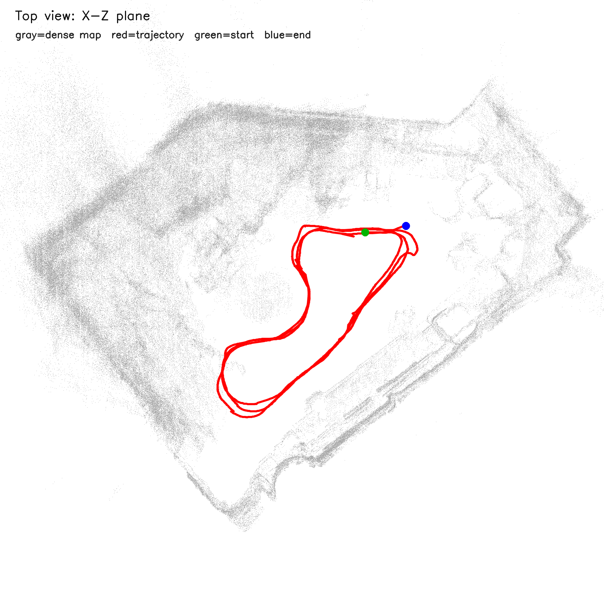

# ORB3-SLAM RGB-D runtime bundle

ROS 2 Humble용 ORB-SLAM3 core와 이 프로젝트의 RGB-D wrapper를 담은 최소 소스 번들이다. ORB-SLAM3는 GPLv3이므로 배포·결합 시 `orbslam_ws/src/ORB_SLAM3/LICENSE`와 upstream의 라이선스 조건을 반드시 확인한다. 입력 bag, vocabulary, 카메라 보정값, 빌드/실행 산출물은 포함하지 않는다.

소스 provenance는 ORB-SLAM3 upstream `4452a3c` 기반의 커스텀 ROS 2 snapshot이며, 내부 이관 commit은 `ae17d6d8ed15ac766019d61fdcebd185123d75c8`이다. 이 번들을 mutable upstream `master`로 대체하면 현재 wrapper 동작이 재현되지 않는다.

## 준비와 빌드

Ubuntu 22.04, ROS 2 Humble, CMake, GCC의 C++14, OpenCV 4, Eigen3, Pangolin, Boost serialization, OpenSSL, spdlog, console_bridge가 필요하다. 공식 소스와 문서는 [ORB-SLAM3](https://github.com/UZ-SLAMLab/ORB_SLAM3), [Pangolin](https://github.com/stevenlovegrove/Pangolin), 카메라 설정 예시는 [ORB-SLAM3 examples](https://github.com/UZ-SLAMLab/ORB_SLAM3/tree/master/Examples)에서 확인한다.

```bash
cd ORB3-SLAM
mamba env create -f environment.yml
conda activate orbslam3
bash scripts/fetch_orb_vocabulary.sh
cd orbslam_ws
rosdep install --from-paths src --ignore-src -r -y
colcon build --symlink-install --executor sequential --parallel-workers 1 \
  --cmake-args -DCMAKE_BUILD_TYPE=Release
source install/setup.bash
```

## 입력 계약과 실행

카메라 intrinsic/depth scale이 맞는 ORB-SLAM3 settings YAML, ROS 2 bag 디렉터리, 동기화된 `sensor_msgs/Image` RGB와 aligned depth가 필요하다. 기본 예제 토픽은 `/camera/camera/color/image_raw`, `/camera/camera/aligned_depth_to_color/image_raw`이며 실제 토픽에 맞게 YAML을 수정한다. vocabulary는 downloader가 `orbslam_ws/src/ORB_SLAM3/Vocabulary/ORBvoc.txt`에 배치한다.

```bash
cd ORB3-SLAM
bash scripts/check_assets.sh ./camera_settings.yaml ./my_rgbd_bag
mkdir -p orbslam_ws/data
cp ./camera_settings.yaml orbslam_ws/data/orbslam3_d455f_640x480_rgbd.yaml
cp -a ./my_rgbd_bag orbslam_ws/data/rgbd_bag
cd orbslam_ws
ros2 launch orbslam3_ros2 orb_slam.launch.py config:=src/orbslam3_ros2/config/no_cli_rgbd.yaml
```

## 검증된 로컬 결과

2026-06-16 KST의 노트북 실행에서 RGB-D 3-lap bag을 처리했고 로그의 최종 카운트는 **3,810 frames**였다. 아래 이미지는 그 실행의 top-view trajectory다. 원본 provenance는 `/home/etri/CLI_environment/orbslam_ws/output/SLAM_three_laps/top_view_trajectory.png`이다.



GT가 없으므로 이 이미지는 정성적 궤적 시각화이며 ATE나 정확도 지표가 아니다. 저장된 trajectory 행 수와 처리 frame 수는 동일하다고 가정하면 안 된다.
