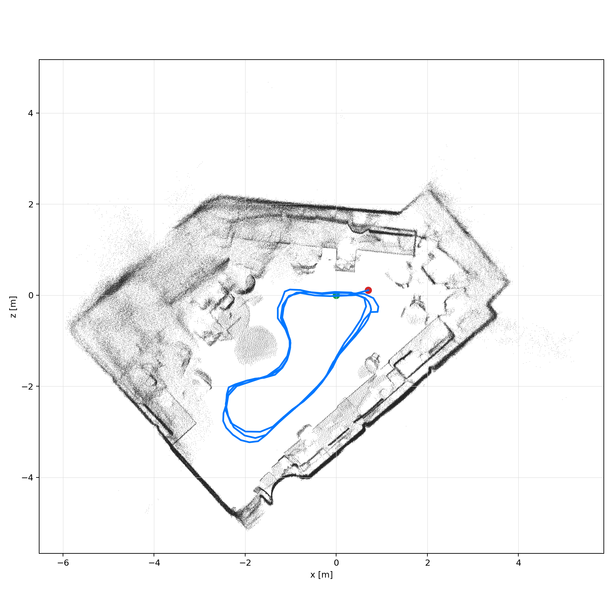

# RTAB-MAP ROS 2 runtime bundle

RTAB-Map core와 ROS 2 wrapper의 runtime source다. 입력 bag, RTAB-Map DB, point cloud, 빌드/출력은 포함하지 않는다. 공식 소스·설치는 [rtabmap](https://github.com/introlab/rtabmap), [rtabmap_ros](https://github.com/introlab/rtabmap_ros), [ROS 2 install guide](https://github.com/introlab/rtabmap_ros/tree/ros2#rtabmap_ros)에서 확인한다. 기본 코어와 ROS wrapper는 BSD이지만 선택적 Madgwick IMU filter 소스·기본 빌드 조합은 GPLv3이므로 `LICENSES/GPL-3.0.txt`도 함께 확인해야 한다.

포함 버전은 core와 ROS 2 wrapper 모두 `0.22.1`이며 내부 이관 snapshot은 commit `ae17d6d8ed15ac766019d61fdcebd185123d75c8`이다. 이후 upstream branch와 자동으로 동일하다고 가정하면 안 된다.

## 환경과 빌드

Ubuntu 22.04와 ROS 2 Humble 기준이다. OpenCV, PCL, SQLite3, Eigen3와 선택한 graph optimizer가 필요하다.

```bash
cd RTAB-MAP
mamba env create -f environment.yml
conda activate rtabmap
cd rtabmap_ws
rosdep install --from-paths src --ignore-src -r -y
colcon build --packages-select rtabmap --cmake-args \
  -DCMAKE_BUILD_TYPE=Release -DBUILD_EXAMPLES=OFF \
  -DPython_EXECUTABLE="$CONDA_PREFIX/bin/python" \
  -DPython3_EXECUTABLE="$CONDA_PREFIX/bin/python"
source install/setup.bash
colcon build --packages-up-to rtabmap_launch --cmake-args \
  -DCMAKE_BUILD_TYPE=Release \
  -DPython_EXECUTABLE="$CONDA_PREFIX/bin/python" \
  -DPython3_EXECUTABLE="$CONDA_PREFIX/bin/python"
source install/setup.bash
```

## 입력 계약과 실행

시간 동기화된 RGB `Image`, aligned depth `Image`, 해당 `CameraInfo`가 필수다. LiDAR ICP를 결합할 때는 `PointCloud2`와 올바른 TF도 필요하다. 토픽명과 QoS는 bag에 맞춰 명시한다. 공식 데이터 안내는 [RTAB-Map datasets](https://introlab.github.io/rtabmap/#datasets)를 참조한다.

```bash
cd RTAB-MAP
bash scripts/check_assets.sh ./my_rgbd_bag \
  /camera/color/image_raw \
  /camera/aligned_depth_to_color/image_raw \
  /camera/color/camera_info
mkdir -p rtabmap_ws/output
source rtabmap_ws/install/setup.bash
ros2 launch rtabmap_launch rtabmap.launch.py \
  rgb_topic:=/camera/color/image_raw \
  depth_topic:=/camera/aligned_depth_to_color/image_raw \
  camera_info_topic:=/camera/color/camera_info \
  qos:=1 qos_image:=1 qos_camera_info:=1 args:=-d \
  database_path:="$(pwd)/rtabmap_ws/output/rtabmap.db"
# 다른 터미널
ros2 bag play ./my_rgbd_bag --clock
```

결과 DB는 위 명령의 `rtabmap_ws/output/rtabmap.db`에 생성된다. `output/`은 Git에서 제외된다.

## 검증된 로컬 결과

2026-06-16 KST RGB-D 3-lap 실행에서 DB는 **145 nodes**, **394 links**였고, export cloud는 **1,396,322 points**, pose export는 **140 poses**였다. 원본 provenance는 `/home/etri/CLI_environment/rtabmap_ws/output/SLAM_three_laps/rtabmap_2d_top_map_trajectory_start_end.png`이다.



GT가 없으므로 node/link/cloud 크기는 처리 결과 수치일 뿐 정확도·완전성 지표가 아니다. 145 nodes와 140 exported poses의 차이도 실패율로 해석할 수 없다.
