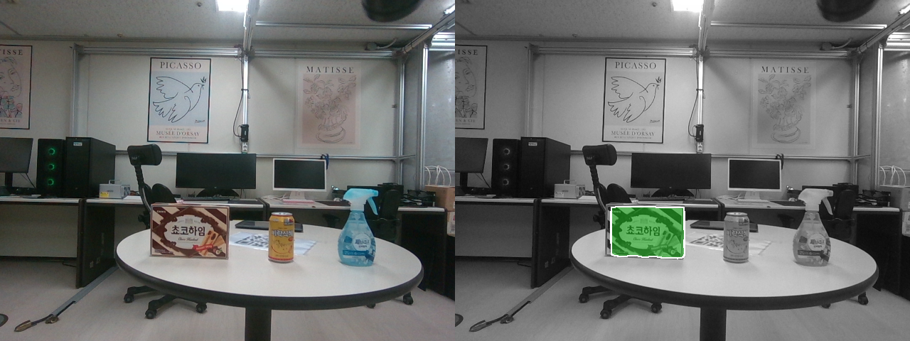
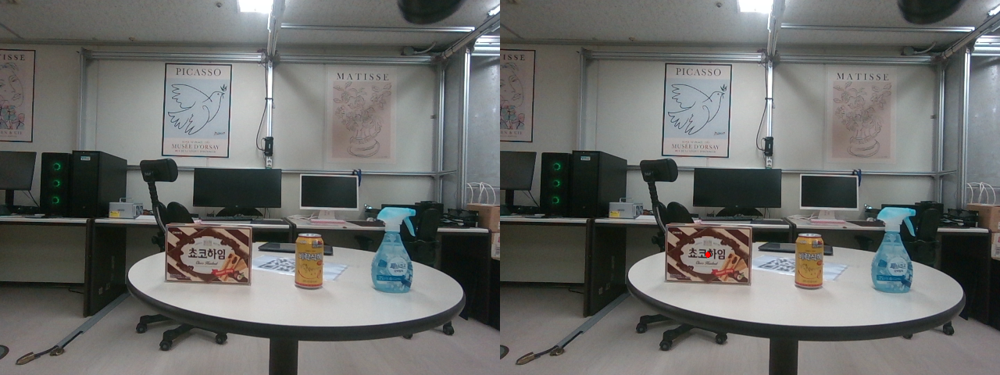

# SAM-6D ROS 2 wrapper bundle

공개 가능한 로컬 ROS 2 wrapper/config와 설치 계약만 포함한다. SAM-6D upstream 전체는 재배포 라이선스가 명확하지 않아 싣지 않았고, installer가 공식 [JiehongLin/SAM-6D](https://github.com/JiehongLin/SAM-6D) revision `1c2543b3b6faa1f1d81b3c7291f8b371d71e50c2`를 detached checkout한다. 사용자는 upstream 조건과 모델별 라이선스를 직접 확인해야 한다. checkpoint, CAD, template, RGB/depth 입력은 포함하지 않는다.

## 환경·설치·빌드

Ubuntu 22.04, ROS 2 Humble, CUDA 호환 GPU 환경을 권장한다. upstream 공식 준비 절차와 checkpoint 링크는 [README](https://github.com/JiehongLin/SAM-6D#1-preparation) 및 `prepare.sh`가 기준이다.

```bash
cd SAM-6D
bash scripts/install_upstream.sh
conda env create -f environment.yml
conda activate sam6d-runtime
cd sam6d_ws/sam6d_master/SAM-6D
bash prepare.sh
cd ../../
source /opt/ros/humble/setup.bash
rosdep install --from-paths src --ignore-src -r -y
colcon build --packages-select sam6d_ros --symlink-install
source install/setup.bash
```

## 입력 계약과 실행

밀리미터 단위 CAD `.ply`, RGB 이미지, millimetre depth 또는 명시된 depth scale, camera intrinsic JSON, 사전 렌더링 template, ISM/PEM checkpoint가 필요하다. ROS wrapper 기본 입력은 `/camera/rgb/image_raw`, `/camera/depth/image_raw`이며 같은 camera frame과 timestamp로 동기화되어야 한다. `sam6d_ws/src/sam6d_ros/config/params.yaml`의 경로는 workspace 상대경로로 지정한다.

```bash
cd SAM-6D
bash scripts/check_assets.sh \
  ./sam6d_ws/sam6d_master/SAM-6D ./object_mm.ply ./camera.json ./templates
mkdir -p sam6d_ws/assets sam6d_ws/runtime_output
cp ./object_mm.ply sam6d_ws/assets/object_mm.ply
cp ./camera.json sam6d_ws/assets/camera.json
cp -a ./templates sam6d_ws/assets/templates
source sam6d_ws/install/setup.bash
ros2 launch sam6d_ros sam6d_inference.launch.py \
  config:=$(pwd)/config/runtime_example.yaml
ros2 service call /sam6d_inference/run std_srvs/srv/Trigger '{}'
```

자체 물체 template은 upstream의 [custom data 절차](https://github.com/JiehongLin/SAM-6D#2-evaluation-on-the-custom-data)에 따라 생성한다. `prepare.sh`가 외부 모델 자산을 내려받으므로 실행 전 URL과 조건을 검토한다.

## 검증된 로컬 결과

2026-06-15 KST saffron/high_texture_around frame `002495` 실행에서 ISM 후보는 **5개**, 최고 ISM score는 **0.3617**였고 PEM 후보는 **2개**, 최고 PEM score는 **0.08535**였다. provenance는 `/home/etri/CLI_environment/sam6d_ws/output/ply_test/saffron/high_texture_around/002495/vis_ism.png`와 `/home/etri/CLI_environment/sam6d_ws/output/ply_test/saffron/high_texture_around/002495/vis_pem.png`이다.





이 score들은 후보 ranking/confidence 값이며 pose 정확도, ADD(-S), 성공률이 아니다. 단일 frame이고 GT 평가가 없으므로 정성적 실행 증거로만 사용한다.
